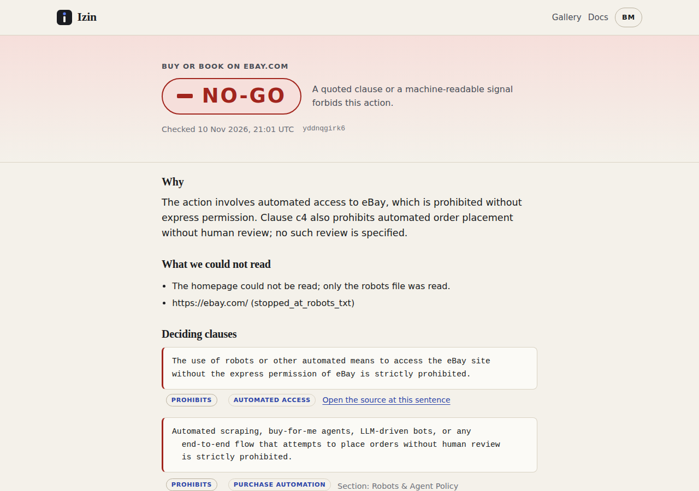

# Izin

Before an AI agent acts on a website, Izin answers GO, ASK or NO-GO for one action and quotes the clause from the site's
robots.txt and terms.

**See a real answer:** [buy or book on ebay.com, NO-GO](https://izin.sasateguh.com/r/yddnqgirk6). eBay's robots.txt
directives leave the home page open to crawlers, and a comment in the same file says "Checkouts are strictly for human
users." A parser skips that comment. Izin quotes it.

[](https://izin.sasateguh.com/r/yddnqgirk6)

## Try it in a minute

1. Open [izin.sasateguh.com](https://izin.sasateguh.com), pick an example or enter a site and an action.
2. Give it to your agent over MCP:

   ```sh
   claude mcp add --transport http izin https://izin.sasateguh.com/mcp
   ```

3. Or call the API. A check is queued and returns an id; the receipt is at `/api/receipt/{id}` and `/r/{id}`.

   ```sh
   curl -s https://izin.sasateguh.com/api/check -H 'content-type: application/json' \
     -d '{"url":"https://www.ebay.com/","action":"purchase"}'
   ```

4. An agent can also pay for a saved answer per call, over x402 on a testnet. See [Who pays, and how](#who-pays-and-how).

The six actions are `read_page`, `crawl`, `train`, `account`, `purchase` and `post`. Endpoints, limits and error codes are
on [/docs](https://izin.sasateguh.com/docs).

## Why

Robots.txt directives can close paths to crawlers. They cannot say who may buy, whether a human must review an order, or
which route is approved. Sites write that in words: comments in robots.txt and their terms. A parser skips both.

The idea came from a hackathon radar that reads more than 20 sources. On 5 Nov 2026 a coding agent, working under my rules,
read the robots.txt and terms of 12 candidate sources before any was added. In 5 of them robots.txt allowed the page and
the terms banned scraping. In 2 the terms could not be read by a script. A robots check alone would have passed all 5.

## Who pays, and how

Izin is for teams that ship agents which buy, book, sign up or post on sites they do not own. Before the agent acts,
the team wants an answer it can keep: what the site's own words say about that action, quoted, with a receipt.

| Tier | Price | Status |
|---|---|---|
| Free | 6 new checks an hour | live |
| Agent, answer from a saved receipt | USD 0.01 a call | live on the Base Sepolia testnet, paid over x402 |
| Agent, fresh reading and decision | USD 0.05 a call | planned |
| Watch | USD 5 a month per 100 sites, re-read nightly | planned |

A decision is saved and reused for 7 days. A fresh decision costs about 1 US cent on SERV (see below); an answer
from a saved receipt makes no model call, so each repeat lookup lowers the cost of an answer.

The paid route answers HTTP 402 with x402 payment terms. An x402 client signs the payment and retries:

```sh
curl -si 'https://izin.sasateguh.com/api/paid/check?url=https://www.ebay.com/&action=purchase'
# HTTP/2 402 with a PAYMENT-REQUIRED header: USD 0.01 in test USDC on Base Sepolia
```

This is a testnet, so the USDC has no value. The route sells saved answers only, charges nothing when no receipt is
saved, and is off unless the deployment sets a receiving address
([ADR 0022](docs/decisions/0022-paid-answer-over-x402-testnet.md)). Checked on 15 Nov 2026 through the public x402
facilitator: a request with no payment gets the terms, a signed payment from a test wallet with no funds is refused
for its balance, and the first funded payment settled. It paid USD 0.01 in test USDC for the eBay answer above:
[transaction on Base Sepolia](https://sepolia.basescan.org/tx/0x19a9401d0de99decc8aa8987ecf312f7e67eddea7cb958b5960464abfda272b3).

## How a verdict is made

```text
 site + action
      |
   IzinBot fetches robots.txt, the home page and the policy pages it links to
      |
 1 Read     Dolphin: an open-weights model returns the clauses that matter, word for word
      |     code: every quote must be found in the fetched text, or it is dropped;
      |           sentences addressed to AI readers are set aside
 2 Decide   SERV Reasoning: a verdict in a strict JSON schema, citing clause ids
      |
 3 Ceilings code: robots.txt, Content Signals, blocks and unread pages cap the verdict;
      |           a GO next to a prohibiting clause becomes ASK; for crawl, account, purchase
      |           and post, so does a GO with no clause quoted from the site's terms;
      |           text addressed to AI readers, or a Crawl-delay on a crawl, caps it at ASK
   receipt  what was fetched and when, the quoted clauses with links, the ceilings, a hash
```

A failure at any step (a block, a page that could not be read, no valid decision) ends in ASK, never GO.

## Where Dolphin runs

The reading step. [`server/baca/reader.ts`](server/baca/reader.ts) (`readDoc`, line 107) sends each policy document to
Dolphin's `deepseek-ai/DeepSeek-V4.1-Flash` ([`config/izin.json`](config/izin.json), `reader.primary`), streamed, at
temperature 0, with thinking off (`reasoning_effort: "none"`). With thinking on, the model spent its whole token budget on
reasoning for three of five real policy pages and returned no JSON ([ADR 0012](docs/decisions/0012-g1-reader-thinking-and-guard-mode.md)).

Why Dolphin: reading every word of a long terms page is cheap there, and open weights mean anyone can re-run the reading
step with the same model. The quote check in [`server/semak/quotes.ts`](server/semak/quotes.ts) (`verifyDocClauses`,
line 69) keeps the reader honest. SERV is the fallback reader if Dolphin fails; the receipt names the model that read.

## Where SERV Reasoning runs

The decision step. [`server/putus/serv.ts`](server/putus/serv.ts) (`requestFor`, line 107; `decide`, line 151) calls
`gpt-6-luna` on SERV with:

- **a strict JSON schema** (`response_format: json_schema`), so the code can check every cited clause id;
- **Shadow Agent** (`serv_shadow_agent`), with a hint that rejects a NO-GO without a prohibiting clause, an ASK without a
  condition, and a GO that cites a prohibiting clause;
- **Prompt Guard** (`serv_prompt_guard`) declared when the code filter flags injected text in a clause or in the caller's
  detail. Declared on every request, it refused 8 of 10 normal policy payloads in the G1 run ([`docs/UKUR-G1.md`](docs/UKUR-G1.md)), so it is not on by default
  ([ADR 0012](docs/decisions/0012-g1-reader-thinking-and-guard-mode.md)).

The gallery run of 10 Nov was decided with Multipath on: its receipts, including the eBay receipt above, name
`gpt-6-luna-serv-multipath`. Checks made since 14 Nov use `gpt-6-luna` without Multipath. The Multipath variants of the
benchmark could not be measured after the credit ran out, and the decider that ships is the configuration the published
numbers describe ([ADR 0017](docs/decisions/0017-shipped-decider-variant.md)). A fresh decision on SERV costs about 1 US cent
(USD 0.0122 a decision in the benchmark, estimated at the cost factor calibrated against the SERV console balance,
[ADR 0019](docs/decisions/0019-serv-cost-from-console-balance.md)). A saved receipt is reused for 7 days and makes no new model call.
When SERV rejects a feature combination, the request steps down a ladder (no Shadow Agent, then the base model, then JSON
checked in code) and the receipt records the rung.

The ceilings are plain code in [`server/putus/siling.ts`](server/putus/siling.ts) (`applyCeilings`, line 79).

## What we measured

All numbers below come from [`docs/UKUR.md`](docs/UKUR.md), which the scripts in `scripts/` generate from stored receipts
and ledgers. That file also lists every counted receipt.

**Gallery run, 10 Nov 2026:** 24 sites, 144 site and action pairs, 144 receipts. GO 0, ASK 123, NO-GO 21. The SERV credit ran
out partway through, so 41 of 144 receipts carry a valid decision; the others stay at ASK.

**Gallery now, 15 Nov 2026:** runs on 14 and 15 Nov decided the pairs left without a decision and checked some pairs
again after ceiling S11, so the gallery shows 144 receipts from three runs. GO 2, ASK 93, NO-GO 49. The decision step
gave a valid answer on 123. On 18 the code decided without calling it (no clause to weigh, or nothing readable) and kept
ASK; on 3 the answer cited a clause that is not in the text, so ceiling S8 applied.

**Words against directives** (current gallery receipts): a robots.txt parser alone answers "allowed" for 126 of the 144
pairs. In **72 of those 126**, a
quoted clause from the site restricts or forbids the action and Izin answered ASK or NO-GO on that clause.

**Benchmark** on 43 pairs fixed before the run (13 recorded decisions, 20 designed cases, 10 spot checks), all variants
deciding on the same frozen evidence:

| Variant | Decider | Agree | False GO | False NO-GO | Cost per decision (USD, estimated) | Median time |
|---|---|---|---|---|---|---|
| V0 | Dolphin `DeepSeek-V4.1-Flash`, no SERV features | 36 of 43 | 1 | 1 | 0.000032 | 3.1 s |
| V1, ships | SERV `gpt-6-luna` | 31 of 43 | 3 | 0 | 0.0122 | 12.9 s |

False GO for the shipped decider in that run: 2 of 20 designed cases, 0 of 10 spot checks, 1 of 13 recorded decisions.
Two came from pages that tell AI readers what to answer (B09, the injection case, and B20): the code set the sentence aside
and only lowered the confidence, and the decision step still answered GO. The third (A09) was a crawl on a site whose
robots.txt sets a Crawl-delay.

**Re-measure with the current ceilings:** two code ceilings now cap those cases at ASK
([ADR 0020](docs/decisions/0020-two-signal-ceilings-and-remeasure.md)), and a third caps a GO for crawl, account, purchase
or post that quotes no clause from the site's terms ([ADR 0021](docs/decisions/0021-go-needs-a-quoted-policy-clause.md)).
That third ceiling also lowers one designed case whose expected answer is GO (B07) to ASK. Applied to the same stored
answers, with no site fetched and no model called:

| Variant | Agree | False GO | False NO-GO |
|---|---|---|---|
| V0 | 36 of 43 | 0 of 43 | 1 of 43 |
| V1, ships | 33 of 43 | 0 of 43 | 0 of 43 |

**Reading cost:** 462,675 tokens read on Dolphin over 57 stored readings, USD 0.006070. In the gallery and benchmark runs,
100% of reader tokens were served by Dolphin.

## Limits

- It does not render JavaScript. A terms page that needs a browser is reported as unread, and the answer is ASK.
- It obeys robots.txt and stops there; a site that blocks IzinBot is reported as blocked.
- GO means no restriction was found in what was read. For crawl, account, purchase and post it also needs a clause
  quoted from the site's terms; silence alone is ASK. Izin reads public text and reports what it says; it is a starting
  point for a decision, not advice.
- The benchmark is small (43 pairs). False GO for the shipped decider in the run: 2 of 20 designed cases, 0 of 10 spot
  checks, 1 of 13 recorded decisions; 0 of 43 after the re-measure with the current ceilings.
- The public instance has daily and total spending caps. When a cap is reached it serves stored receipts and makes no new model calls.
- The paid route runs on a testnet and sells saved answers only. Nothing on the site takes real money.

## Related work

- [Maango](https://github.com/maango-io/maango-mcp) (MIT) answers content-use questions (train, scrape, summarize, index)
  per domain from AI-policy standards, over MCP.
- [Permission manifests for web agents](https://arxiv.org/abs/2601.02371) (`agent-permissions.json`) propose a robots.txt
  style file for agent actions.
- [IETF AI Preferences](https://datatracker.ietf.org/wg/aipref/about/), [RSL](https://rslstandard.org/),
  [TDMRep](https://www.w3.org/community/tdmrep/) and [Content Signals](https://contentsignals.org/) are machine-readable
  signals for AI use of content. Izin reads Content Signals when a site publishes them.
- [ToS;DR](https://tosdr.org/) summarises terms for people.

Where Izin differs:

1. It covers agent actions (buy, open an account, post) that sites state in words, not in directives.
2. Every quote is checked by code against the fetched text and kept in a receipt.
3. It reads the site itself at the time of the check, not a registry record.

## Run it

Node 22 and npm.

```sh
npm ci
npm run build
IZIN_FAKE=1 npm start          # http://localhost:8080, recorded fixtures, no keys, no network calls to models
```

With keys, copy `.env.example` to `.env`, set `SERV_API_KEY` and `DOLPHIN_API_KEY`, and run `npm start`. Tests:
`npm test` (unit, no network) and `npm run e2e` (browser). Values such as actions, limits, prices and caps live in
[`config/izin.json`](config/izin.json); UI text lives in [`lang/en.json`](lang/en.json) and [`lang/ms.json`](lang/ms.json).
Decisions are recorded in [`docs/decisions/`](docs/decisions/).

## IzinBot

Izin fetches pages with an honest user agent, `IzinBot/0.1 (+https://izin.sasateguh.com/bot)`. It obeys robots.txt, does not
render JavaScript, uses no proxies, and does not try to get past blocks or challenges. A site that blocks it is reported as
blocked. That is a finding, not an error.

**For site owners:** [/bot](https://izin.sasateguh.com/bot) explains what IzinBot fetches and how to block it. Izin quotes
your words back to the agent that asked, with a link to the sentence.

## Built for

Built for SERV Hackathon 02 (Dolphin track), November 2026, by [@aimanmalib_](https://x.com/aimanmalib_). Initial commit:
`888ec0a`.

## AI disclosure

Built with Claude Code. The code, tests and text in this repository were written by an AI coding agent working under my
rules. The problem comes from my own work. I decide what ships.

## Disclaimer

Izin reads public text and reports what it says. Its answers are a starting point for a decision, not advice.

## License

MIT. See [LICENSE](LICENSE).
