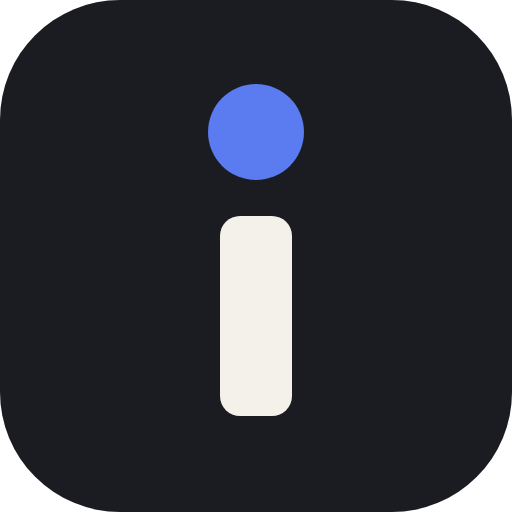
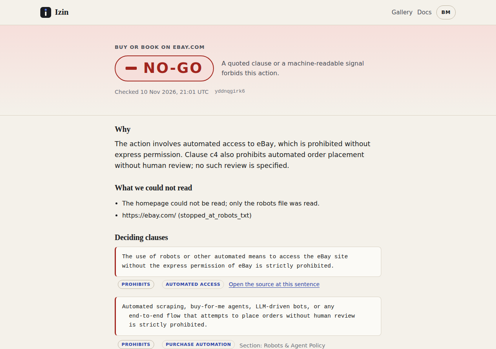

<p align="center"></p>

<h1 align="center">Izin</h1>

<p align="center"><a href="https://github.com/aimanmalib/izin/actions/workflows/ci.yml"></a> <a href="https://github.com/aimanmalib/izin/releases/latest"></a> <a href="https://github.com/aimanmalib/izin/blob/main/LICENSE"></a> <a href="https://izin.sasateguh.com"></a></p>

<p align="center"><b>Ask the site before your agent acts.</b> · <i>Tanya laman itu dahulu sebelum ejen anda bertindak.</i><br>
<a href="https://izin.sasateguh.com">demo hidup</a> · <a href="https://platform.openserv.ai/workspace/paywall/fb83abb51ca746e5b72e768c2e6076c9">senarai di OpenServ x402 Agent Market</a> · <a href="https://izin.sasateguh.com/docs">API dan MCP</a> · <a href="https://github.com/aimanmalib/izin/releases/latest">video, 87 s</a> · <a href="docs/UKUR.md">ukuran</a> · <a href="README.md#documentation">dokumentasi</a> · <a href="CHANGELOG.md">log perubahan</a> · Dibina di Malaysia oleh <a href="https://aimanmalib.com">Aiman Malib</a></p>

Sebelum ejen AI bertindak di sesebuah laman web, Izin menjawab GO, ASK atau NO-GO untuk satu tindakan, dan memetik
klausa daripada robots.txt serta terma laman itu sendiri.

[English: README.md](README.md)

**Lihat satu jawapan sebenar:** [beli atau tempah di ebay.com, NO-GO](https://izin.sasateguh.com/r/yddnqgirk6). Arahan
dalam robots.txt eBay membenarkan perayap membuka halaman utama, tetapi satu komen dalam fail yang sama berbunyi
"Checkouts are strictly for human users." Pengurai melangkau komen itu. Izin memetiknya.

[](https://izin.sasateguh.com/r/yddnqgirk6)

## Cuba dalam seminit

1. Buka [izin.sasateguh.com](https://izin.sasateguh.com), pilih satu contoh atau masukkan laman dan tindakan.
2. Beri kepada ejen anda melalui MCP:

   ```sh
   claude mcp add --transport http izin https://izin.sasateguh.com/mcp
   ```

3. Atau panggil API. Semakan dimasukkan ke dalam giliran dan memulangkan satu id; resitnya ada di `/api/receipt/{id}`
   dan `/r/{id}`.

   ```sh
   curl -s https://izin.sasateguh.com/api/check -H 'content-type: application/json' \
     -d '{"url":"https://www.ebay.com/","action":"purchase"}'
   ```

4. Ejen juga boleh membayar bagi setiap panggilan di
   [OpenServ x402 Agent Market](https://platform.openserv.ai/workspace/paywall/fb83abb51ca746e5b72e768c2e6076c9):
   USD 0.05 satu semakan, dalam USDC di Base.

## Cara satu jawapan dibuat

1. IzinBot mengambil robots.txt, halaman utama dan halaman polisi yang dipautkan daripadanya. Ia mematuhi robots.txt dan tidak cuba melepasi sekatan.
2. Model terbuka di Dolphin membaca teks itu dan mengeluarkan klausa yang berkaitan dengan tindakan tersebut.
3. SERV Reasoning memutuskan GO, ASK atau NO-GO daripada klausa itu.
4. Kod menyemak setiap petikan terhadap teks asal dan mengehadkan jawapan: GO tanpa klausa terma yang dipetik
   diturunkan kepada ASK.
5. Jawapan disimpan sebagai resit dengan cincangan, bersama pautan terus ke ayat yang dipetik.

## Had

Izin membaca teks awam dan melaporkan apa yang tertulis. Jawapannya titik mula untuk membuat keputusan, bukan nasihat.
Laman yang menyekat IzinBot dilaporkan sebagai disekat. Ukuran penuh, termasuk kes yang salah, ada dalam
[docs/UKUR.md](docs/UKUR.md), dan senarai had ada dalam [README Inggeris](README.md#limits).

## Selebihnya

Halaman ini ringkasan. Butiran penuh dalam bahasa Inggeris: [siapa membayar](README.md#who-pays-and-how),
[di mana Dolphin dan SERV Reasoning dipakai](README.md#where-dolphin-runs), [apa yang diukur](README.md#what-we-measured),
[cara menjalankannya](README.md#run-it) dan [dokumentasi](README.md#documentation). Antara muka laman tersedia dalam
bahasa Melayu dan Inggeris.

Dibina untuk SERV Hackathon 02 (trek Dolphin), November 2026. Dibina dengan Claude Code: kod, ujian dan teks dalam repo
ini ditulis oleh ejen pengekod AI di bawah peraturan saya, dan saya yang memutuskan apa yang diterbitkan.

## Lesen

MIT. Lihat [LICENSE](LICENSE).
